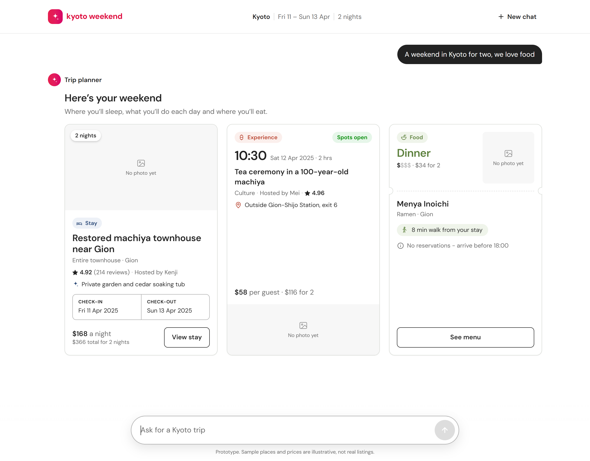
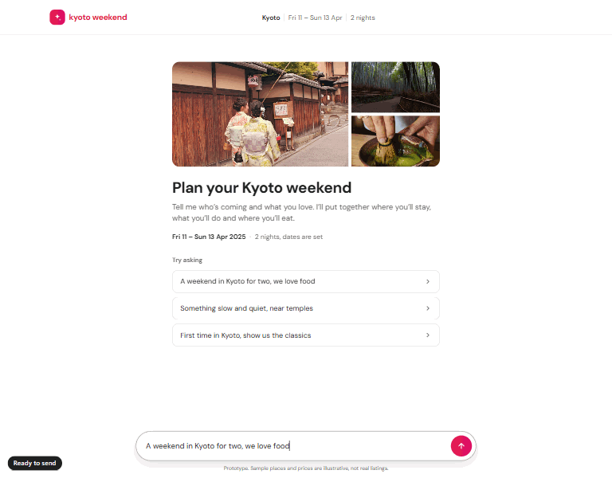
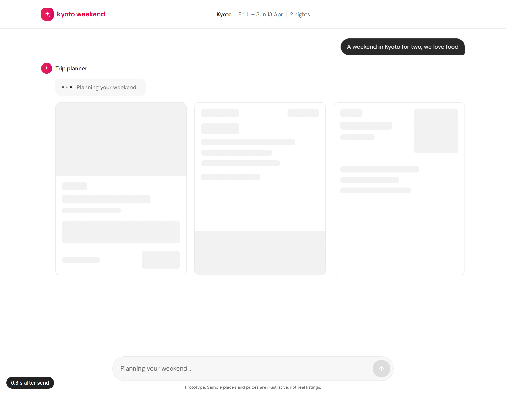
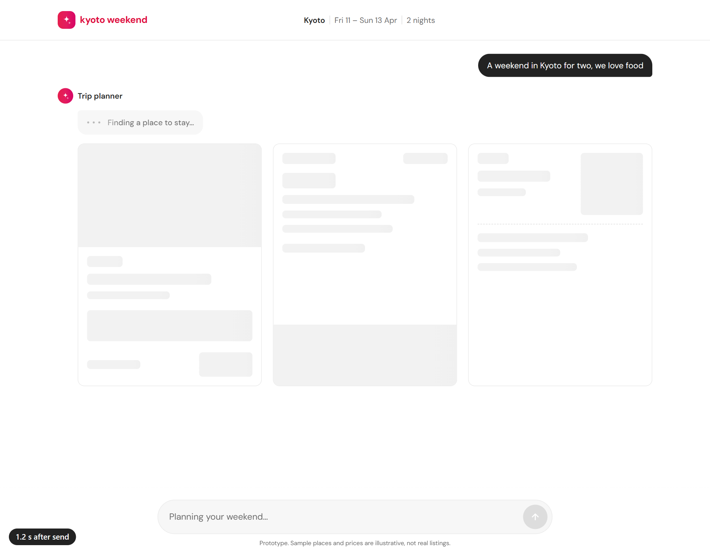
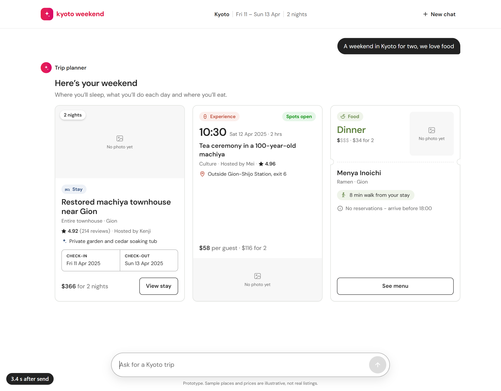

# Kyoto trip-planner chat

**Run it:** `npm install && npm run dev`, then open http://localhost:3000.

## What it does

- Send any trip request. The input locks and pulsing dots show in the reply bubble for about 2 seconds.
- The reply is three cards, always in this order: Stay, Experience, Food.
- Each card is its own component with its own image spot, biggest text and accent colour.
- Any empty field shows a short filler line ("Not listed yet", "TBC", "No photo yet"), never a blank or `undefined`.

## Send to cards: thinking animation and input lock

Measured in the app (two runs, timer counted from pressing Enter):

| Moment | Time |
| --- | --- |
| Input locks ("Planning your weekend…") and pulsing dots appear in the reply bubble | ~0.05 s |
| Dots disappear, Stay, Experience and Food cards appear, input unlocks | ~2.05 s |

The dots run for 2 seconds: `requestPlan` waits for the mock API and a 2 s minimum (`MIN_THINKING_MS` in `src/components/chat/Chat.tsx`). The "s after send" badge in the bottom corner is a timer added only for the recording; it isn't part of the app.

| 1. Just sent: input locked, dots pulsing | 2. Still thinking (1.2 s) | 3. Cards in, input unlocked |
| --- | --- | --- |
|  |  |  |

## Where things live

| Piece | File |
| --- | --- |
| Mock rows, one from each content-pack sheet (Stays, Experiences, Food) | `src/data/kyoto-weekend.ts` |
| Fake API, `POST /api/plan`, returns the three items | `src/app/api/plan/route.ts` |
| Card components | `src/components/cards/StayCard.tsx`, `ExperienceCard.tsx`, `FoodCard.tsx` |
| Filler line for empty fields | `src/components/cards/Filler.tsx` |
| Chat, input lock and thinking timing | `src/components/chat/Chat.tsx`, `Composer.tsx` |

The mock rows are Stays S1, Experiences E1 and Food F1 from the *Kyoto Weekend Prototype Content
Pack*: $366 + $116 + $34 = $516 for 2 guests, inside the pack's $600 reference budget. Prices are
USD as in the pack. The pack has no photo URLs (image rights not cleared), so each card's image
spot shows "No photo yet".

**Stay price:** the Stay card shows $366 for 2 nights, the workbook's "Total for 2 Nights" for two
guests. The $168 nightly rate is left off on purpose: 168 × 2 = 336, and the workbook doesn't
explain the $30 gap, so showing both would put two prices on the card that don't agree.
